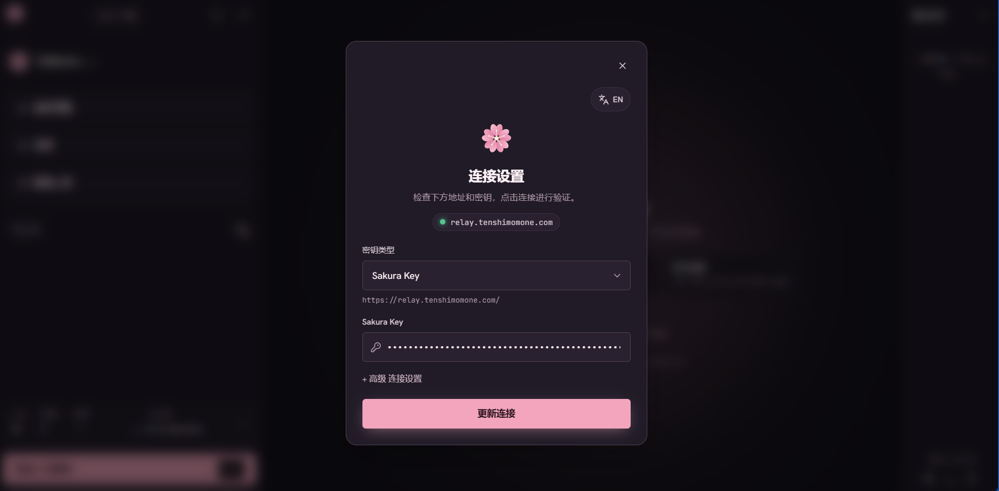

# 星绘补给站｜NovelAI 兑换与接入教程

**付款后先兑换：** [点击打开密钥兑换页](https://redeem.tenshimomone.com/)，具体步骤见下方第 1 节。兑换成功后，根据你使用的网页、客户端或酒馆插件选择第 2～8 节接入。

**新手必看疑问：** 关于 **V4.5 无限小图与 V5 体力的区别**、小图规格标准、点数计算，以及「100 点能出几张图」的解释，统一放在**文末第 9 节**。

## 1. 兑换密钥与查看套餐

付款后先兑换密钥，再按你使用的网页、客户端或酒馆插件填写。

| 项目 | 内容 |
| --- | --- |
| 兑换页 | https://redeem.tenshimomone.com/ |
| 网页在线画图地址 | https://nai.tenshimomone.com/ |
| 第三方接口地址 | `https://relay.tenshimomone.com/` |
| API Key / Token | 兑换页给出的完整密钥，以 `skr_` 开头 |

**重要提示：** Key 输入框只粘贴 `skr_` 开头的密钥本身，**不要加 `Bearer ` 前缀**。兑换页上的中转地址和上表中的第三方接口地址是同一个。请妥善保管你的完整密钥，不要发到公开群聊或截图中。

1. 付款后，在聊天窗口复制以 `CDK-` 开头的兑换码。
2. 打开 [兑换页](https://redeem.tenshimomone.com/)，粘贴兑换码，点击 **兑换**。
3. 页面会给出中转地址和完整密钥（`skr_...`）。**请当场复制保存！** 每枚兑换码只能兑换一次，关闭页面后将无法再次查看密钥。
4. 若没来得及复制保存，请把 `CDK-` 兑换码**私发给客服**，客服可在后台帮你查出对应密钥。

**各档套餐权益如下，有效天数从兑换成功时开始计算：**

| 规格 | 有效天数 | 点数 | V4.5 标准小图权益 | V5 体力上限（跑 V5 小图专用） |
| --- | ---: | ---: | --- | --- |
| 体验：100点数 | 30 | 100 | 无（按点数扣除） | 无 |
| 体验：1天Opus | 1 | 0 | ✅ 无限免点生成 | 4%（约 44 张，一次性发放不恢复） |
| 按量：2k点数包 | 30 | 2,000 | 无（按点数扣除） | 无 |
| **月卡：V4.5无限小图（无V5体力）** | **30** | **0** | **✅ 无限免点生成** | **无（不支持 V5，请选 V4.5 模型）** |
| 月卡：4人Opus无限小图（无点） | 30 | 0 | ✅ 无限免点生成 | 25%（上限 280 张，每 24h 恢复 40 张） |
| 月卡：4人Opus无限小图+2k点 | 30 | 2,000 | ✅ 无限免点生成 | 25%（上限 280 张，每 24h 恢复 40 张） |
| 月卡：单人独享Opus（含1w点） | 30 | 10,000 | ✅ 无限免点生成 | 100%（上限 1,120 张，每 24h 恢复 160 张） |

> **关于本站与 NovelAI 官网 V5 体力条计算方式的区别：**
>
> 本站的 V5 体力额度、体力上限及可生成张数，统一按 **NovelAI V5 单张 28 步（Steps）** 的消耗进行**保守折算**；NovelAI 官网公布的体力条参考数据则采用 **23 步**的计算口径。
>
> **28 步与 23 步的单张体力消耗不同**，因此即使体力条显示相同百分比，按两种口径换算出的可生成张数也不一定相同。本站采用 28 步作为折算基准，是为了避免按较低步数高估可生成张数。
>
> 本站的 **4% / 25% / 100%** 为本站套餐 V5 体力档位，**不可直接套用官网 23 步口径换算张数**。本站对应的 **约 44 / 280 / 1,120 张**及恢复数量，以本站套餐与实际系统规则为准。
>
> **注意：28 步是本站计算 V5 体力额度时采用的保守基准，不代表每次生图必须设置成 28 步。** 符合本站小图规则的 V5 图片，在 **28 步及以下**成功生成 1 张，均扣除 **1 张本站 V5 体力**。这与官网按生成参数浮动计算体力消耗的方式不同。

**额度与恢复规则，再强调一次：**

- **普通点数档（100点 / 2k点）：** 无无限小图与 V5 体力权益，生成任何图片均按点数扣除。
- **月卡：V4.5无限小图（无V5体力）：** 享 30 天 **V4.5 标准小图无限免点数生成**，不包含 V5 体力与额外点数。**使用时请务必将模型选为 V4.5（如 `nai-diffusion-4-5-full`）**；若选择 V5 模型或超规格生成（大图/超28步/单次多张），会因无 V5 体力与点数而被拒绝。
- **1 天 Opus：** 享 1 天 V4.5 标准小图无限生成 ＋ 兑换时一次性发放约 **44 张 V5 体力**（用完不自动恢复）；密钥有效期为 1 天。
- **4人合租 Opus（25% 体力档）：** 享 30 天 V4.5 标准小图无限生成 ＋ V5 体力上限 **280 张**（每 **24 小时恢复 40 张**）。
- **单人独享 Opus（100% 体力档）：** 享 30 天 V4.5 标准小图无限生成 ＋ V5 体力上限 **1,120 张**（每 **24 小时恢复 160 张**）。
- **V5 体力恢复不超过上限。** 含 V5 体力的会员生成符合要求的 V5 小图时，成功生成 1 张扣 1 张 V5 体力；若当日 V5 体力用尽且无点数，**可随时将模型切换为 V4.5 继续免费无限生成小图**，或等待 V5 体力恢复。
- **超出尺寸（宽×高 > 1,048,576）、超出步数（> 28 步）、批量出图多出来的张数，或 V5 体力不足时继续跑 V5**，均需消耗点数。如果点数和对应体力都不够，本次生成会被拒绝。到期后密钥停止使用，需使用新兑换码或联系客服续期。

## 2. 网页直接使用

1. 打开 [星绘网页](https://nai.tenshimomone.com/)，电脑和手机浏览器均可直接使用。
2. 在连接窗口选择 **Sakura Key**。
3. 粘贴兑换页上的 `skr_` 密钥，点击 **连接**（或 **更新连接**）。
4. 连接成功后，选择模型（**V4.5 月卡用户请选 V4.5 模型**；含 V5 体力或点数用户可选 V5 / V4.5），填写提示词，点击 **生成**。



## 3. Aaalice NAI Launcher

[下载客户端](https://github.com/Aaalice233/Aaalice_NAI_Launcher/releases/latest)，按你的设备系统选择安装包。

1. 打开软件，在登录方式中选择 **第三方站点**。
2. 按下表填写：

| 字段 | 填写内容 |
| --- | --- |
| 第三方 API 站点 | `https://relay.tenshimomone.com/` |
| 图像 API 站点（可选） | 留空，或填写同一个接口地址 |
| 昵称 | `星绘补给站` |
| API Token | 兑换页上的 `skr_` 密钥 |

3. 点击 **验证并登录**。
4. 进入绘图工作台，选择对应模型（V4.5 月卡用户请选 V4.5）、确认尺寸与步数（小图建议 ≤ 1024×1024、步数 ≤ 28）后填写提示词生成。

## 4. Langbai NovelAI Studio

[下载客户端](https://github.com/2786886095/novelai-image-desktop/releases/latest)，按你的设备系统选择安装包。

1. 打开软件，进入 **设置 → API 配置**。
2. 先设置接口和开关，再填写 Token：

| 字段 / 开关 | 设置内容 |
| --- | --- |
| 图片接口（NovelAI 官方 / 兼容中转） | `https://relay.tenshimomone.com/` |
| 允许使用非官方接口 | 开启 |
| 中转鉴权失败后改用官方重试 | 关闭 |
| API Token | 兑换页上的 `skr_` 密钥 |

3. 点击 **验证并保存 Token**（部分版本显示“验证 Token”）。
4. 打开 **生成 → 文生图**，选择对应模型（V4.5 月卡用户请选 V4.5），填写提示词后生成。

## 5. 酒馆：柏宝绘

1. 在 SillyTavern 的 **扩展 → 安装扩展** 中粘贴仓库地址：

```text
https://github.com/baibai-git/ST-BaiBai-Image
```

2. 安装后刷新页面，打开 **柏宝绘 → 渠道 → NovelAI → 配置**。
3. 在 **接入点** 旁点击 **＋**，新建一条接入点，命名为“星绘补给站”（官方默认接入点的地址不能修改，必须新建）。
4. 填写以下内容：

| 字段 | 填写内容 |
| --- | --- |
| 接口地址 | `https://relay.tenshimomone.com/` |
| API Key | 兑换页上的 `skr_` 密钥 |

5. 点击 **使用此渠道出图**，确认当前选中“星绘补给站”接入点，并选择你要使用的模型（**「V4.5无限小图」月卡用户请务必选择 V4.5 模型**；含 V5 体力或点数用户可选 V5 或 V4.5）。
6. 在插件 **设置** 中，将 **生成 tag 使用** 保持为 **跟随主 API**，继续使用你原来的聊天连接。
7. **自动配图：** 开启 **自动生成 tag** 和 **自动生成图片**。**手动配图：** 关闭这两个开关，在 AI 回复的 **⋯** 菜单里点调色盘，生成提示词后点击卡片上的 **生成图片**。

*注：本站密钥只填在 NovelAI 的接入点中，酒馆聊天模型仍使用你原本的聊天 Key，互不冲突。*

## 6. 酒馆：小白X / LittleWhiteBox

已有小白X的用户可直接使用它的 NovelAI 模块（选择一种酒馆绘图插件使用即可，无需同时开多个）。

1. 在酒馆 **扩展 → 安装扩展** 中粘贴：

```text
https://github.com/RT15548/LittleWhiteBox
```

2. 安装后刷新，打开小白X设置，在 **AI 画图 → 画图后端** 中选择 **NovelAI**，点击 **画图设置**。
3. 打开 **API 配置**，按下表填写并点击 **保存**：

| 字段 | 填写内容 |
| --- | --- |
| NovelAI API Key | 兑换页上的 `skr_` 密钥 |
| 第三方端点 URL（可选） | `https://relay.tenshimomone.com/` |
| 发送方式 | 前端直连 |

4. 在 **绘图参数** 中选择模型（**V4.5 月卡用户请选 V4.5 模型**；含 V5 体力或点数用户可选 V5 或 V4.5），并确认步数 ≤ 28、尺寸 ≤ 1024×1024。
5. 在 **场景 Agent**（部分版本叫“LLM 配置”）中选用酒馆主 API，或填写你自己的聊天模型连接。
6. 点击 AI 消息旁的 **🎨** 手动配图；需要自动配图时，切换为 **自动模式**。

## 7. 酒馆：智绘姬 / st-chatu8

1. 在酒馆 **扩展 → 安装扩展** 中粘贴仓库地址：

```text
https://github.com/damoshen123/st-chatu8
```

2. 安装后刷新页面，打开 **智绘姬（st-chatu8）** 的设置面板。在 **主要设置** 中开启 **启用插件**，将 **模式** 选为 **NovelAI**，将 **客户端** 选为 **浏览器**。
3. 切换到左侧 **NovelAI** 页面，按下表填写：

| 字段 / 开关 | 设置内容 |
| --- | --- |
| NovelAI API | 兑换页上的 `skr_` 密钥 |
| 站点 | 其他站点 |
| 其他novelai站点 | `https://relay.tenshimomone.com/` |
| 启用云端队列 | 关闭 |
| 队列服务地址 | 留空 |

4. 在下方 **模型** 中选择你要使用的模型：
   - **含 V5 体力或点数用户：** 可选 `nai-diffusion-5-full`（V5）或 `nai-diffusion-4-5-full`（V4.5）。
   - **「月卡：V4.5无限小图（无V5体力）」用户：** 请务必选择 **`nai-diffusion-4-5-full`**（或 V4.5 Curated），切勿选 V5。
5. 已有智绘姬配图预设的用户，继续按原来的方式生图即可。本站密钥填在 **NovelAI API** 中，酒馆聊天或插件 LLM 仍使用你原来的聊天模型连接。

## 8. 其他支持第三方 NovelAI 的工具

| 字段 | 填写内容 |
| --- | --- |
| 服务类型 | NovelAI |
| 第三方地址 / Base URL | `https://relay.tenshimomone.com/` |
| API Key / Token | 兑换页上的 `skr_` 密钥 |

支持 NovelAI 原生接口、并允许自定义接口地址（Base URL）的工具，都可以按这组信息接入。

## 9. 新手常见问题：小图、点数、V4.5 与 V5 体力到底是什么？

> **先说明：** 星绘补给站是 **NovelAI 兼容的第三方绘图接入服务**。本站密钥**不是 NovelAI 官网账号**；概念和计价方式参考官网，但本站套餐的点数、V4.5 无限小图、V5 体力、恢复速度及有效期，均以本文和实际系统规则为准。

**一句话理解：小图是符合尺寸与步数标准的图片规格；Opus 会员跑 V4.5 小图完全免费不限量，跑 V5 小图则优先扣「V5 体力」；超规格大图或无会员时则扣「点数」。**

| 你看到的词 | 通俗解释 | 最容易搞混的地方 |
| --- | --- | --- |
| **小图（标准图）** | 指满足**宽×高 ≤ 1,048,576 像素、步数 ≤ 28、单次生成 1 张**的图片规格 | 不等于低画质，也不是只能画 512×512（常用的 832×1216、1024×1024 都算小图！） |
| **V4.5 无限小图** | 所有月卡及 1 天 Opus 均含此权益：用 **V4.5 模型**画符合条件的小图，**不扣点数也不扣 V5 体力，30 天无限畅画** | 若购买的是「V4.5无限小图（无V5体力）」月卡，**只能免点画 V4.5 小图**，不能画 V5 或超规格大图 |
| **V5 体力** | 专为 **V5 模型**设置的可用小图张数额度（1天/4人/单人 Opus 专属），用完后按 24 小时周期恢复 | 只有画 **V5 小图**才会扣 V5 体力；画 V4.5 小图不扣 V5 体力！当 V5 体力用完时，切回 V4.5 仍可继续无限画小图 |
| **点数** | 用来支付绘图消耗的钱包余额，类似官网的 **ImageAnlas（生图点数）** | **100 点数不等于 100 张图**，每次消耗点数多少与模型、尺寸、步数有关 |

### 9.1 什么才算「小图」？V4.5 和 V5 小图有什么区别？

在本站规则中，无论你使用 V4.5 还是 V5，享受「小图免点/扣体力权益」都需要**同时满足以下 3 个规格条件**：

1. **宽 × 高 ≤ 1,048,576 像素**（约 100 万像素）。
2. **Steps／步数 ≤ 28**。
3. **单次生成 1 张**（批量出图中多出来的图片会改扣点数）。

**在满足上述 3 个条件时，选不同模型的扣费区别：**

- **选择 V4.5 模型（如 `nai-diffusion-4-5-full`）：** 只要你持有有效期内的任意 Opus 套餐（含 `1天Opus`、`月卡：V4.5无限小图`、`4人Opus`、`单人独享Opus`），每张 **0 点数、0 体力消耗，真正无限生成**！
- **选择 V5 模型（如 `nai-diffusion-5-full`）：** 需要你的套餐包含 **V5 体力**（如 `1天Opus`、`4人Opus`、`单人独享Opus`），每成功生成 1 张扣 **1 张 V5 体力**（不扣点数）。若你买的是 `月卡：V4.5无限小图（无V5体力）`，因不含 V5 体力与点数，无法使用 V5 模型。

**常见尺寸举例（以本站的宽×高 ≤ 1,048,576 像素规则判断）：**

| 图片尺寸 | 像素数量 | 算本站的小图吗？ |
| --- | ---: | --- |
| 512 × 512 | 262,144 | ✅ 算，同时满足步数 ≤ 28、单次 1 张即可 |
| 768 × 1024 | 786,432 | ✅ 算，同时满足步数 ≤ 28、单次 1 张即可 |
| 832 × 1216 | 1,011,712 | ✅ **算（最常用人像/酒馆配图黄金尺寸）** |
| 1024 × 1024 | 1,048,576 | ✅ **算（刚好卡在上限内）** |
| 1024 × 1536 | 1,572,864 | ❌ 超出像素上限，属于大图，必须扣点数 |

> **注意：**「小图」只是对官网标准免费额度范围（Standard Size）的简称，1024×1024 和 832×1216 清晰度已经非常高！**哪怕选了小图尺寸，一旦把步数调到 29 或更高，就会超出小图规则，改走点数计费。**
>
> **28 步与官网 23 步的区别：** 28 步是本站 V5 体力额度的**保守折算基准**，同时也是本站小图规则允许的步数上限；只要符合小图尺寸且单次 1 张，23 步、28 步或更低步数生成的 V5 小图，在本站均按 **1 张 V5 体力**扣除（生成 V4.5 小图则完全免费）。

### 9.2 什么是「点数」？什么时候会扣点？

把点数理解成**绘图钱包里的余额**即可。以下情况会消耗点数：

- **纯点数套餐（100点 / 2k点）：** 没有 Opus 权益，生成任何图片（无论 V4.5 还是 V5）均按点数计费。
- **生成超规格图片（大图 / 高步数）：** 宽×高超过 `1,048,576` 像素，或步数超过 `28 步`，不论什么套餐均需扣点数。
- **一次生成多张（Batch > 1）：** 符合条件的第一张走小图权益，**多出来的张数**按点数扣除。
- **V5 体力用尽后继续强跑 V5：** 当日 V5 体力扣完后，若不切换回 V4.5 而继续使用 V5 生成，会自动改扣账户内的点数；**若此时点数也为 0，请求会被拒绝**（无点版用户此时只需把模型切成 V4.5，即可继续免费画小图！）。

**重点：点数不是「张数」。** 「100 点数」表示有 100 点绘图余额，**不等于能画 100 张图**。每张图的扣点与模型、尺寸、步数、生成张数等设置有关。

### 9.3 常见问题：100 点数到底能生成多少张图？

**100 点数包是 100 点绘图余额，不是 100 张次数卡。** 本站的「体验：100 点数」有效期为 **30 天**，不附带无限小图或 V5 体力，生成时按点数消耗。

如果使用 **普通文生图、一次只生成 1 张、不使用额外收费功能**，下面是按照 NovelAI 官网计费方式所做的**参考估算**：

| 示例设置 | 预计每张消耗 | 100 点数大约能出 |
| --- | ---: | ---: |
| V5 / V4.5 · 512×512 · 23 步 | 约 **8 点** | **12 张** |
| V5 / V4.5 · 832×1216 · 23 步 | 约 **20～26 点** | **3～5 张** |
| V5 / V4.5 · 1024×1536 · 28 步 | 约 **45 点** | **2 张** |

> **以上只是参考，不承诺固定张数。** 本站的实际扣点应以生成时的计费信息或余额变化为准；不同模型、分辨率、步数、附加功能或客户端实现，都可能改变消耗。
>
> **特别区分：** 本表是**普通点数扣费**的示例，23 步或 28 步会影响预估点数；前文所说的“本站按 28 步保守折算”，指的是 **Opus V5 体力额度换算口径**，不是说所有按点计费的图片都统一按 28 步扣点。

**最准确的测算方法：** 先选好模型、图片尺寸、步数，查看网页或客户端生成按钮显示的预计扣点；如果插件不显示，可先出 **1 张**，对比前后余额差。使用酒馆自动配图时，每轮对话自动触发生成也会持续扣点。

*参考：* [NovelAI 官方：步数与点数关系](https://docs.novelai.net/en/image/stepsguidance/) · [针对 NovelAI 计价规则的第三方估算说明（2026-08）](https://github.com/RhNu/novelai-bridge/blob/main/docs/anlas-pricing.md)。

### 9.4 四种 Opus 档位（「V4.5月卡」「4人Opus」「单人独享」「1天Opus」）有什么区别？

NovelAI 官网的 **Opus** 订阅在跑 V4.5 标准小图时不限量，而在跑最新 **V5** 模型时同样设有会随时间恢复的体力上限（并非 V5 也能无限制狂刷）。

**本站据此提供了清晰的四个阶梯档位，按需选择即可：**

- **月卡：V4.5 无限小图（无 V5 体力）：** 30 天内享 **V4.5 标准小图无限免点生成**，不含 V5 体力与额外点数。适合只用 V4.5 画图或酒馆日常长驻自动配图、追求极致性价比的玩家。
- **月卡：4 人 Opus（25% V5 体力档）：** 30 天内享 **V4.5 无限小图** ＋ **V5 体力上限 280 张**（每 24 小时恢复 **40 张**，上限不叠加）。有「无点版」和「含 2000 点数版」可选。
- **月卡：单人独享 Opus（100% V5 体力档）：** 30 天内享 **V4.5 无限小图** ＋ **V5 体力上限 1,120 张**（每 24 小时恢复 **160 张**）＋ **10,000 点数**。
- **体验：1 天 Opus（4% V5 体力档）：** 24 小时有效期内享 **V4.5 无限小图** ＋ 一次性发放**约 44 张 V5 体力**（用完不再恢复，不含额外点数）。

### 9.5 四个例子，一眼看懂怎么扣费

| 你要生成的设置 | 月卡：V4.5无限小图(无V5) | 4人 / 单人 / 1天 Opus（V5体力充足时） | 纯点数包（100点 / 2k点） |
| --- | --- | --- | --- |
| **V4.5**，832×1216，28 步，1 张 | ✅ **完全免费（0点0体力）** | ✅ **完全免费（0点0体力）** | 扣本次所需点数 |
| **V5**，1024×1024，28 步，1 张 | ❌ 不支持（无V5体力与点数） | ✅ **扣 1 张 V5 体力**，不扣点数 | 扣本次所需点数 |
| **V5 / V4.5**，1024×1536（大图），28 步 | ❌ 不支持（无额外点数） | 超出小图尺寸，**扣点数**（无点版会拒绝） | 扣本次所需点数 |
| **V5 / V4.5**，1024×1024，30 步（超步数） | ❌ 不支持（无额外点数） | 超出 28 步上限，**扣点数**（无点版会拒绝） | 扣本次所需点数 |

**新手省心建议：** 日常画图和酒馆自动配图，强烈建议固定使用 **832×1216 或 1024×1024、28 步及以下、每次 1 张**。买「V4.5无限小图月卡」的朋友固定选 V4.5 模型即可 30 天无限畅画；买「4人合租 Opus」的朋友平时可尽情跑 V5，万一当天 V5 体力刷完了，切回 V4.5 就能继续无缝免费出图！

### 9.6 不知道买哪档？按需求对号入座

| 你的实际需求 | 推荐对应档位 | 需要注意 |
| --- | --- | --- |
| 想花 1 块钱测试接口通不通、偶尔画几张 | **体验：100 点数** | 只有 100 点数（约出 3～12 张图），不带无限小图与体力 |
| 想低成本测试 V5 效果和 V4.5 无限小图 | **体验：1 天 Opus** | 含 1 天 V4.5 无限小图 + 约 44 张 V5 体力（一次性不恢复） |
| 画图频率很低，但每次都要画超大图/高步数 | **按量：2k 点数包** | 只有 2,000 点数，按实际参数扣点，30 天有效 |
| **酒馆长驻自动配图、日常高频跑 V4.5 小图** | **🔥月卡：V4.5 无限小图（无V5体力）** | **性价比最高！30 天 V4.5 小图无限出，注意模型必须选 V4.5** |
| **主要想玩最新 V5 模型小图 + V4.5 无限小图** | **🔥月卡：4 人 Opus 无限小图（无点）** | 25% V5 体力（上限 280 张/日恢复 40 张）+ V4.5 无限小图 |
| 既想用 V5 体力画小图，偶尔也要画大图/加精 | **月卡：4 人 Opus 无限小图+2k 点** | 25% V5 体力 + V4.5 无限小图 + 2,000 点数 |
| 重度创作者，每天大量跑 V5 与高精大图 | **月卡：单人独享 Opus（含1w点）** | 100% 满额 V5 体力（上限 1,120 张）+ V4.5 无限小图 + 10,000 点数 |

> **官网参考：** [NovelAI 订阅与 ImageAnlas 说明](https://docs.novelai.net/en/subscription/) · [NovelAI Opus V5 使用额度 FAQ](https://docs.novelai.net/en/faq/) · [官网关于 V5 体力机制的解释](https://journal.novelai.net/opus-usage-limit-explained/)。这些链接用于理解官方概念，**本站实际可用额度、扣费与有效期以本站的套餐表为准**。
